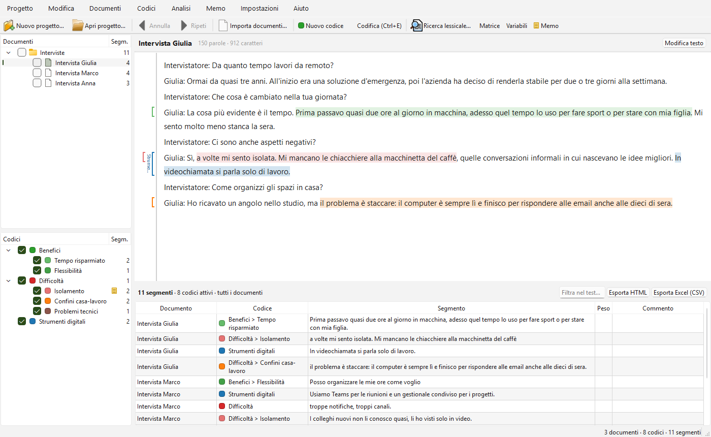

# Tessera

**Tessera** è un software desktop per Windows dedicato all'analisi qualitativa dei dati:
importi interviste e documenti, costruisci un sistema di codici, codifichi i brani di testo,
scrivi memo e confronti i risultati tra documenti.

È scritto in C++20 con Qt 6. Lo scambio con altri software QDA avviene tramite lo standard aperto
**REFI-QDA (.qdpx)**.



## Download

Scarica `Tessera-x.y.z-win64.zip` dalla pagina
[Releases](https://github.com/lucaberto95/Tessera/releases), estrai la cartella e avvia
`Tessera.exe`. In alternativa, se la release lo include, scarica l'installer `Tessera-x.y.z-setup.exe`: installa per l'utente corrente senza diritti di amministratore, crea il collegamento nel menu Start e associa i file `.tsra` (doppio clic = apre il progetto). La versione ZIP non richiede installazione: Qt e il runtime di Visual C++ sono già inclusi.

Per provarlo subito, usa **Progetto → Crea progetto di esempio…**: crea tre interviste sul lavoro
da remoto, già codificate, con variabili e memo.

## Funzionalità

| Area | Cosa fa |
|---|---|
| **Progetti** | Ogni progetto è un singolo file (`.tsra`, SQLite) salvato automaticamente a ogni modifica. Ci sono i progetti recenti e "Salva una copia come…". |
| **Annulla / Ripeti** | `Ctrl+Z` / `Ctrl+Y` funzionano su ogni operazione della sessione (fino a 200 passi), anche su eliminazioni, importazioni e codifica automatica. |
| **Documenti** | I documenti si organizzano in gruppi e si importano da TXT/MD, DOCX, ODT, RTF, PDF e HTML. I **set di documenti** raccolgono documenti di gruppi diversi (trascinandoli su un set o dai documenti attivi) e si attivano con un clic. Importando DOCX, ODT, RTF e HTML si conserva la formattazione principale (titoli, grassetto, corsivo, sottolineato, barrato, elenchi puntati e numerati, tabelle). Si possono creare documenti incollando del testo e modificarne il testo: le codifiche si adattano da sole. |
| **Immagini** | PNG, JPG, GIF e BMP (e TIFF e WebP, se Qt ha i relativi plugin) si importano come documenti (`Ctrl+I`), salvati dentro il progetto; l'orientamento EXIF è applicato. Nel visualizzatore la rotella ingrandisce, il tasto centrale sposta l'immagine, «Adatta» e «100%» regolano lo zoom. Trascina un rettangolo per selezionare un'area e codificala come un testo (`Ctrl+E`, menu contestuale o trascinando un codice): le aree si colorano col codice e un clic su un'area mostra codici e commento. Nei segmenti recuperati l'area è una miniatura e nell'export HTML il ritaglio è incorporato come immagine. |
| **PDF** | All'import di un PDF si sceglie «Come PDF (consigliato)» o «Solo testo». Come PDF le pagine si vedono com'erano (scorrimento continuo, Ctrl+rotella per lo zoom, «Larghezza» e «100%», casella «Pagina»); il file originale sta nel progetto. Trascinando si seleziona del testo, con Alt + trascinamento un rettangolo (figure, tabelle): la selezione si codifica come l'altro testo (Ctrl+E, menu contestuale, trascinando un codice) e diventa un'area con il testo associato. Le aree si colorano col codice, nel margine di ogni pagina ci sono le barre dei codici e un clic su un'area mostra codici e commento. Nei segmenti recuperati si vede il testo dell'area (o una miniatura se non c'è); la ricerca lessicale, le frequenze e i dizionari leggono il testo estratto. |
| **Sondaggi** | «Importa dati di sondaggio (Excel/CSV)…» (menu Documenti) legge un questionario da `.xlsx` o `.csv`, una riga per rispondente. In un'anteprima ogni colonna si segna come ID rispondente, variabile (con tipo), risposta aperta o da ignorare: ogni rispondente diventa un documento con le risposte aperte, ciascuna dopo la sua domanda e codificata con un codice che ha il nome della domanda; le altre colonne diventano variabili del documento. Le risposte vuote si saltano; tutto l'import si annulla con un solo `Ctrl+Z`. |
| **Collegamenti** | Un brano si collega a un altro brano, dello stesso documento o di un altro: seleziona il testo e scegli «Inizia collegamento» (`Ctrl+L`), poi seleziona la destinazione e scegli «Completa collegamento» (`Ctrl+Shift+L`). Il testo collegato è blu e sottolineato; `Ctrl+clic` apre l'altra estremità. La finestra «Collegamenti…» (menu Documenti) li elenca tutti con commento. Le estremità seguono le modifiche del testo. |
| **Codici** | Sistema di codici gerarchico con colori, descrizioni e memo, riorganizzabile con il trascinamento e con le frequenze sempre visibili. |
| **Codifica** | Seleziona il testo e trascinaci sopra un codice, oppure usa `Ctrl+E` (codice selezionato), `Ctrl+Shift+E` (nuovo codice) o il menu contestuale. Il testo codificato è evidenziato con il colore del codice e una barra laterale mostra le parentesi dei codici. Ogni segmento può avere commento e peso. |
| **Recupero segmenti** | Attiva documenti e codici con le caselle di spunta: il pannello in basso raccoglie i segmenti corrispondenti, con filtro ed esportazione in HTML, Excel (.xlsx) o CSV. |
| **Memo** | Memo su progetto, gruppi, documenti, codici e segmenti, o memo liberi; un memo si può collegare a più elementi (con "Aggiungi…" o trascinandovi codici e documenti) e compare su ognuno. Una finestra li raccoglie tutti, con esportazione. |
| **Variabili** | Variabili dei documenti tipizzate (testo, intero, decimale, sì/no, data), modificabili in una tabella, con import CSV ed export Excel (.xlsx) o CSV (all'import il tipo di ogni colonna viene riconosciuto e si può correggere in un'anteprima). «Attiva per variabili…» attiva i documenti che soddisfano condizioni sulle variabili (es. Genere = F E Età ≥ 40). |
| **Analisi** | Ricerca lessicale (più termini con OR, parole intere, espressioni regolari) con codifica automatica della parola, della frase o del paragrafo. Matrice codici × documenti con heatmap, frequenze dei codici e grafico. Frequenze di parole (lista di parole escluse, confronto per gruppo, set o variabile), nuvola di parole e parole in contesto (KWIC) con apertura del documento, esportabili. |
| **Accordo tra codificatori** | «Accordo tra codificatori…» (menu Analisi): si confrontano due autori delle codifiche nello stesso progetto (dopo un'unione) oppure questo progetto e un altro file `.tsra` con gli stessi documenti. Tre livelli: presenza del codice nel documento, frequenza, segmenti (con soglia di sovrapposizione). Tabella per codice e totale con accordo %, kappa di Cohen e kappa di Brennan-Prediger; elenco dei disaccordi con il testo, doppio clic per aprire il documento sul punto; esportazione in Excel, CSV e HTML. |
| **Dizionari** | «Dizionari e analisi del contenuto…» (menu Analisi): dizionari con categorie e sottocategorie, ognuna con parole ed espressioni di più parole, anche con `*` come jolly (`lavor*`). Le voci si importano da Excel/CSV (colonne Categoria e Voce) o da un elenco di parole in un file di testo, e si esportano in Excel o CSV. L'analisi conta le occorrenze di ogni categoria per documento (conteggi o % delle parole, con le variabili accanto, esportabile in Excel/CSV/HTML); la codifica automatica codifica la parola, la frase o il paragrafo con un codice scelto o creato per ogni categoria, in un solo passo di annulla; i conteggi si salvano come variabili dei documenti. |
| **Sintesi** | «Griglia delle sintesi…» (menu Analisi): matrice documenti × codici, segmenti della cella al centro, editor della sintesi a destra, salvata da sola (scrivere una sintesi è un solo passo di annulla). «Tabelle riassuntive…»: tabelle salvate con documenti (o un set) come righe e codici e variabili come colonne, che si aggiornano al cambiare delle sintesi; esportabili in Excel, CSV e HTML. Le sintesi non viaggiano nel QDPX. |
| **Collaborazione** | «Unisci un altro progetto…» (menu Progetto): aggiunge a questo progetto il lavoro di un'altra copia (.tsra o .qdpx) senza duplicare nulla: documenti, codici, codifiche, memo, sintesi, collegamenti, variabili, set e dizionari, riconosciuti per identificatore o per nome. Riepilogo prima di confermare, opzione «solo le codifiche di un autore», documenti con testo diverso importati come copia o saltati, memo in conflitto concatenati con l'autore. Un solo passo di annulla. Il nome utente si chiede al primo avvio. |
| **Interoperabilità** | Importazione ed esportazione QDPX (REFI-QDA) di documenti testuali, codici, codifiche, memo, variabili, gruppi e collegamenti tra brani (i dizionari non fanno parte del formato). |
| **Report** | «Crea report…» (menu Progetto): documento pronto da allegare a una tesi con copertina, indice, codebook (gerarchia, colori, descrizioni, frequenze, esempi di segmenti), segmenti codificati raggruppati per codice o per documento (con commenti), memo, variabili e tabelle riassuntive. Formati Word .docx (stili veri Titolo 1-3, Citazione e indice automatico, tabelle Word), PDF e HTML. |
| **Excel** | Segmenti, codebook, variabili, memo, matrici, co-occorrenze e statistiche si esportano in Excel `.xlsx` nativo (il CSV resta disponibile): intestazioni in grassetto con filtro e riga bloccata, colore del codice come sfondo, heatmap delle matrici, numeri e date come valori veri. «Esporta tutto il progetto in Excel…» (menu Progetto) crea una cartella di lavoro con documenti, codici, segmenti, variabili e memo, un foglio ciascuno. |

### Scorciatoie

| Tasti | Azione |
|---|---|
| `Ctrl+N` / `Ctrl+O` | Nuovo progetto / apri progetto |
| `Ctrl+I` | Importa documenti |
| `Ctrl+K` | Nuovo codice |
| `Ctrl+E` | Codifica la selezione con il codice selezionato |
| `Ctrl+Shift+E` | Codifica la selezione con un nuovo codice |
| `Ctrl+L` / `Ctrl+Shift+L` | Inizia / completa un collegamento dalla selezione |
| `Ctrl+clic` | Su un testo collegato: apre l'altra estremità del collegamento |
| `Ctrl+Z` / `Ctrl+Y` | Annulla / ripeti |
| `Ctrl+F` | Cerca nel documento aperto (barra di ricerca; `F3` / `Maiusc+F3` per scorrere, `Esc` per chiudere) |
| `Ctrl+Shift+F` | Ricerca lessicale su tutto il progetto |
| `Ctrl+M` | Matrice codici × documenti |
| `Ctrl+Shift+M` | Tutti i memo |
| `Ctrl+rotella` | Zoom del testo (e dei PDF) |
| `Alt` + trascinamento | In un PDF: seleziona un rettangolo da codificare |

## Compilare dai sorgenti

Requisiti:
- Visual Studio 2022 o Build Tools con il carico di lavoro C++, che include già CMake e Ninja.
- Qt 6.8 o successivo per MSVC 2022 64 bit, con i moduli `qtpdf` e `qtcharts`. Gli script cercano
  Qt in `C:\Qt\6.10.3\msvc2022_64`; se è altrove, imposta la variabile `QTDIR`.

```bat
build.cmd Release
deploy.cmd zip
deploy.cmd installer   :: richiede Inno Setup 6
```

`build.cmd` compila nella cartella `build\Release`. `deploy.cmd zip` prepara la cartella
autonoma `dist\Tessera` e lo zip per la release.

Test (senza aprire finestre):

```bat
set PATH=C:\Qt\6.10.3\msvc2022_64\bin;%PATH%
set QT_QPA_FONTDIR=C:\Windows\Fonts
build\Release\tessera_tests.exe -platform offscreen
build\Release\tessera_ui_tests.exe -platform offscreen
```

## Struttura del codice

```
src/core/   modello dati, persistenza SQLite, undo/redo, import/export, QDPX (nessun widget)
src/ui/     interfaccia Qt Widgets
tests/      test della logica (test_core) e dell'interfaccia in modalità offscreen (test_ui)
```

I dettagli di architettura, le convenzioni e le insidie già incontrate sono in [CLAUDE.md](CLAUDE.md).

## Limiti attuali

- Oltre ai testi si codificano le aree di immagini e PDF; niente audio e video. Immagini e PDF non vanno ancora nel QDPX. Nei PDF non c'è ancora la ricerca nel documento (Ctrl+F): si usa la ricerca lessicale del progetto, che porta alla pagina.
- La cronologia di annullamento vale per la sessione e si azzera chiudendo il progetto.
- Non ci sono il lavoro di gruppo né il confronto tra codificatori.
